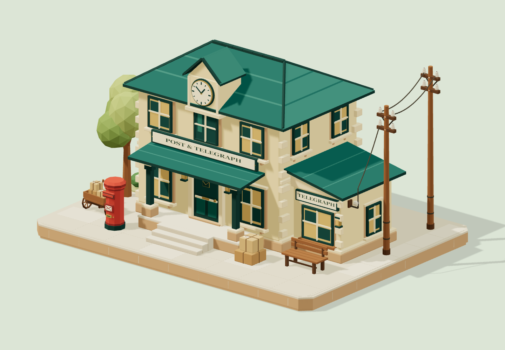
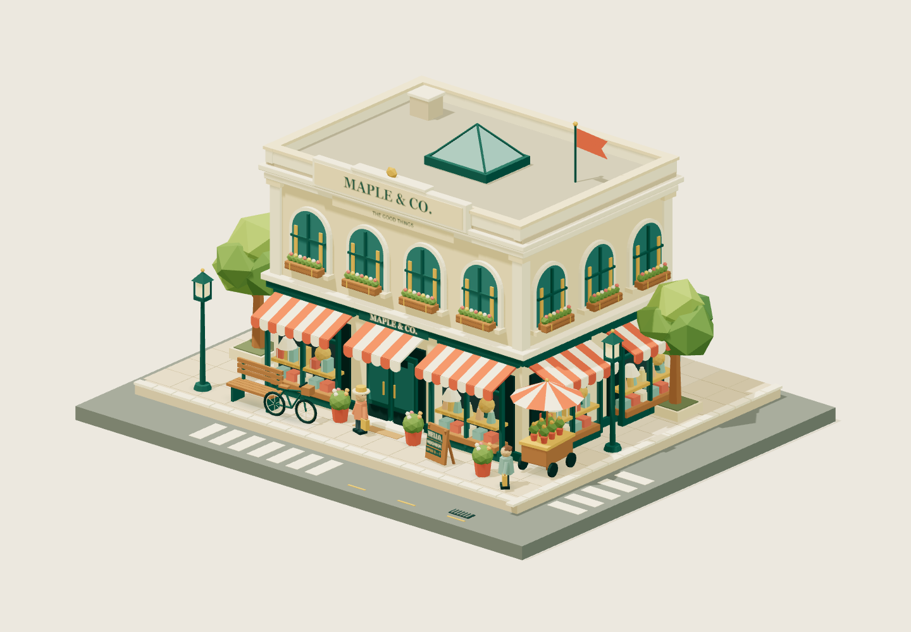
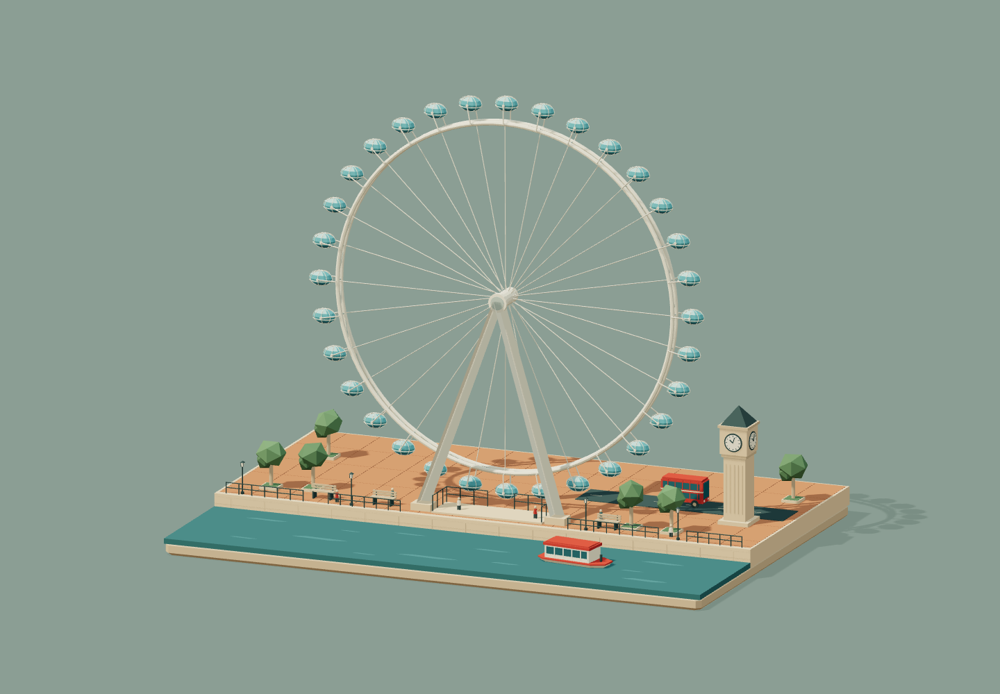

# Three.js / WebGL 3D Pipeline

**English** | [简体中文](README.zh-CN.md)

Turn a scene description into a working, interactive Three.js experience through a six-stage workflow with multiple agents and screenshot-based review.

This repository contains an **AI coding skill and example projects**. It is not a rendering engine, hosted image-generation service, or one-click model-generation API. The skill covers requirements, spatial blueprints, modular development, independent review, lighting comparisons, material refinement, and model export.

[Install the skill](docs/installation.md) · [Usage guide](docs/usage.md) · [Examples](examples/README.md) · [Contributing](CONTRIBUTING.md)

The detailed guides linked above and the skill instructions are currently written in Chinese. This README provides the English overview, installation steps, usage example, and validation commands.

## Three demos

| Demo | Preview | Features | Format |
| --- | --- | --- | --- |
| [Juniper Post & Telegraph](examples/postal.html) |  | Low-poly architecture, mail delivery, telegraph light, camera presets, and wireframe | Standalone HTML + [modular source](examples/postal-diorama/) |
| [Maple & Co. Department Store](examples/store.html) |  | Day/night toggle, department information, and street-corner views | Standalone HTML with embedded Three.js |
| [London Eye Riverside Miniature](examples/london-eye.html) |  | Rotating and pausable observation wheel, riverside scene, camera presets, and wireframe | Standalone HTML with embedded Three.js |

These screenshots are actual browser renders. All three demos are available as standalone HTML files: download one and open it in a browser, with no Node.js installation or local server required.

**On GitHub**, the links in the table open HTML source-file pages. Download the raw file, save it with the `.html` extension, and open it locally. GitHub's file viewer does not execute the page. Alternatively, run the local gallery using the commands below to access all three demos.

## Run the examples locally

Clone the repository, or download and extract its ZIP archive:

```sh
git clone https://github.com/darks/threejs-webgl-3d-pipeline.git
cd threejs-webgl-3d-pipeline
```

For development, use **Node.js 22.12+** and a modern browser with WebGL support. From the repository root:

```sh
npm ci
npm run dev
```

Open the local URL printed in the terminal, usually `http://127.0.0.1:5173/`. You can also open `examples/postal.html`, `examples/store.html`, or `examples/london-eye.html` directly. The standalone postal demo is generated from its modular source; after editing that source, run `npm run build:postal` to refresh the standalone file.

```sh
npm run check
npm run build
npm run preview
```

The `dist/` directory contains the gallery and all three demos. Relative asset paths allow deployment under a static site's subdirectory. Open the URL printed by the preview server. This repository does not publish the site automatically.

## Install the skill

Installing the skill itself does not require `npm ci`. With Node.js available, run this command from the repository root:

```sh
node scripts/install-skill.mjs
```

The default destination is `$CODEX_HOME/skills/threejs-webgl-3d-pipeline`, or `~/.codex/skills/threejs-webgl-3d-pipeline` when `CODEX_HOME` is unset. If that directory already exists, the installer stops rather than overwriting your changes. You can also copy the entire [skills/threejs-webgl-3d-pipeline](skills/threejs-webgl-3d-pipeline) folder manually. See the [installation guide](docs/installation.md) for additional options.

Example prompt:

```text
$threejs-webgl-3d-pipeline Create a Western-style, low-poly cartoon post office.
Put all outputs in a new, dedicated directory. Support orbiting, zooming,
mail delivery, and an interactive telegraph light.
```

## Workflow

1. **Requirements and concept:** Separate Producer and Director agents discuss the brief and establish a SPEC and visual reference.
2. **Spatial blueprint:** An Architect defines coordinates, scale, cameras, modules, and contact relationships.
3. **Implementation and export:** A Lead_Dev delegates module development and integrates interactions, tuning parameters, OBJ/GLB export, and four-view capture.
4. **Independent review:** A fresh, read-only Critic actually inspects the images and evaluates geometry, layout, lighting, and style.
5. **Lighting comparison:** Candidates use the same cameras, seed, and animation time. Parameter snapshots and selection rationale are retained.
6. **Material refinement:** A recoverable version is saved before comparing against a target image, making improvements, and repeating checks, captures, and independent review.

The visual gate requires an arithmetic mean of at least 9.0 across the four scores, no unresolved blocker or major issues, and passing engineering checks. Scores document review judgments; they are not an objective quality guarantee. The authoritative rules and iteration budgets are in [SKILL.md](skills/threejs-webgl-3d-pipeline/SKILL.md) and the [execution contract](skills/threejs-webgl-3d-pipeline/references/execution-contract.md).

## Capabilities and limitations

- The complete pipeline requires a host with isolated agent contexts, filesystem and command execution, browser automation, and actual image viewing. A text-only chat cannot complete all acceptance checks. Image generation is optional; unavailable capabilities must be documented.
- The updated skill requires **GLB / OBJ export** controls on the delivered HTML page, with download and reload verification. **The three existing showcase demos do not yet include export buttons.** They demonstrate scenes, interactions, and project organization, rather than full compliance with every requirement in the latest contract.
- The store and London Eye HTML files contain minified application code and Three.js. Their original modular source projects are not included. The postal example includes both editable modules and a reproducible standalone build.
- Users provide the software, model access, and browser environment required by the skill. Performance depends on the device; measurements from the original production machine are not presented as results for your environment.

## Validation

```sh
npx playwright install chromium
npm run build
npm run test:smoke
npm run test:standalone
```

The smoke test starts a temporary preview server and checks loading, camera presets, basic interactions, and mobile viewports for the three demos. Screenshots and results are written to the Git-ignored `artifacts/smoke/` directory. Set `CHROMIUM_PATH` to use an existing Chromium executable. These are package smoke tests, not a new run of the six-stage creative review process. See the [testing guide](docs/testing.md) for details.

## Repository layout

```text
skills/threejs-webgl-3d-pipeline/   Installable skill and execution contract
examples/postal.html              Standalone postal HTML, generated from modules
examples/postal-diorama/          Postal source, parameters, specs, and checks
examples/store.html              Standalone department-store HTML
examples/london-eye.html         Standalone London Eye HTML
docs/                           Installation, usage, testing, and screenshots
scripts/                        Installation, package checks, and browser tests
index.html                      Gallery linking to all three demos
```

## License

Original project code, skill documentation, and example content are released under the [MIT License](LICENSE). Bundled and imported Three.js code retains its MIT copyright notices; see [third-party notices](THIRD_PARTY_NOTICES.md). Screenshots illustrate the examples in this repository. Names, locations, and text in the demos do not imply affiliation with real-world organizations.
